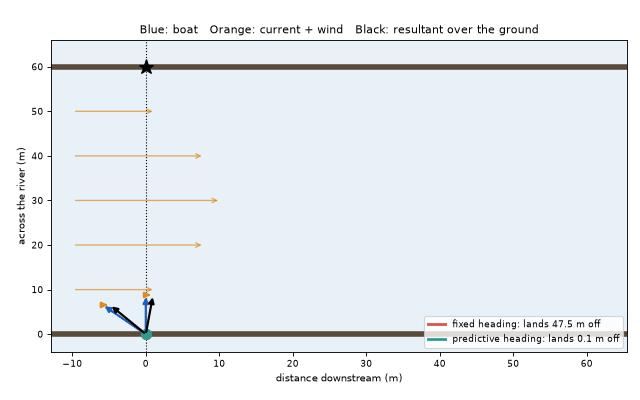
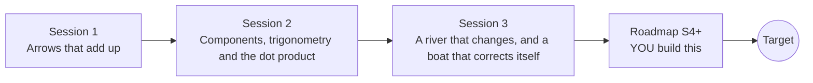

# openvectors

[](https://github.com/KrunalPanchal1995/openvectors/actions/workflows/ci.yml)   [](https://colab.research.google.com/github/KrunalPanchal1995/openvectors/blob/main/sessions/session-01/lesson.ipynb) [](https://krunalpanchal1995.github.io/openvectors/)

**Add forces and velocities as arrows and land a boat across a river, in three sessions.**

openvectors teaches vectors through one story: a boat, a river with a current, and the arrows that decide where it lands, using only Python and a browser.

- **Start from zero.** Session 1 needs only a ruler-and-arrow idea of direction; every symbol is explained.
- **See it move.** Every session ships a slider app with arrows and labelled graphs that run in the browser.
- **Know you got it right.** Each session ends with a checkpoint that prints PASS or FAIL against hand calculations and exact formulas.
- **Build the missing half.** The repo stops at Session 3 on purpose; the roadmap shows the path to the Target.

[Target](#the-target) · [Who is this for](#who-is-this-for) · [Quick start](#quick-start) · [Sessions](#sessions) · [Roadmap](#roadmap) · [Contribute](#contribute) · [Explainer PDF](docs/explainer.pdf)

> **This repo is incomplete on purpose.** Sessions 1 to 3 are here and fully working. The finished Target below is a preview of what the community can build next. We show you the path, not the code. Sessions 4 and up are yours.

## The Target

A ferry crosses a 60 m river that flows fastest in the middle, with a gusting side wind. Two boats start together. The red one keeps one heading straight across and arrives about 47 m downstream of its landing. The green one re-aims every moment and lands on the target, and you can see why: the blue arrow (the boat), the orange arrow (current and wind) and the black arrow (the resultant over the ground) are drawn on both boats all the way. Your goal over the coming sessions: build the green boat yourself.



*Target: a fixed heading (red) versus a heading that corrects itself (green), with the vector arrows*

Try it live:

- [Math Visual Studio (Studio root; open the Atlas chapter S06, Vectors, from there)](https://krunalpanchal1995.github.io/studio/)

How the Target was made is shown only as a path in [promo/roadmap.md](promo/roadmap.md).

## Who is this for
**secondary school to diploma / undergraduate (levels 3-5).** Topic area: Mathematics and Visual Problem-Solving.

Prerequisites:

- Sine, cosine and Pythagoras for a right-angled triangle (school trigonometry); Session 1 needs only the idea of speed and direction.
- Python 3.10 or newer; if `python --version` works, you are ready. PRIMER.md explains the rest.
- No prior GitHub, physics or programming-library experience is needed.

New to Python? Read [PRIMER.md](PRIMER.md) first (10 minutes).

## Quick start

No installation knowledge needed. You need [Git](https://git-scm.com/downloads) and [Python 3.10+](https://www.python.org/downloads/) (Windows: tick "Add Python to PATH"). On Mac and Linux type `python3` wherever this page says `python`.

```bash
git clone https://github.com/KrunalPanchal1995/openvectors.git
cd openvectors
python start.py 1
```

`start.py` creates a private environment, installs what is needed and runs Session 1 with its checkpoint. Next: `python start.py 2`, `python start.py 3`, or `python start.py test` to check everything. Only a checkpoint: `python start.py check 1`.

Four lines turn the idea of Session 1 into a result (they work as they are): Save it as `try.py` and run it with `python start.py run try.py` (this uses the private environment, where NumPy is installed):

```python
import numpy as np
boat = np.array([0.0, 4.0])        # 4 m/s straight across the river
current = np.array([2.0, 0.0])     # 2 m/s downstream
ground = boat + current            # arrows add: [2. 4.]
print(ground, 60 / ground[1] * ground[0])   # lands 30.0 m downstream
```

Every session also opens in your browser with sliders (no install): [live apps](https://krunalpanchal1995.github.io/openvectors/). Or use the Colab badge above for the notebook.

## Sessions

| # | Session | Model level | Time | Live app |
|---|---|---|---|---|
| 1 | [Arrows that add up](sessions/session-01/README.md) | Level 1: conceptual interactive model | 60 min | [open](https://krunalpanchal1995.github.io/openvectors/session-01/) |
| 2 | [Components, trigonometry and the dot product](sessions/session-02/README.md) | Level 2: mathematical engineering model | 75 min | [open](https://krunalpanchal1995.github.io/openvectors/session-02/) |
| 3 | [A river that changes, and a boat that corrects itself](sessions/session-03/README.md) | Level 3: simulation and validation | 90 min | [open](https://krunalpanchal1995.github.io/openvectors/session-03/) |

Each session follows the same six steps: A real-world problem, B concept and theory, C visual explanation, D interactive simulation, E worked example and experiment, F assessment and design challenge. Each ends with `checkpoint.py`, which prints `PASS` or `FAIL` against reference numbers. Session 3 also contains the real-world mini-project: **Plan a ferry route**.

## Architecture



| Folder or file | What is inside |
|---|---|
| `sessions/` | three sessions: README (A-F), `lesson.py`, notebook, live app, exercises, activity sheet, checkpoint |
| `promo/` | the Target: media, live links, and the roadmap (path only) |
| `docs/` | `explainer.tex` and the built `explainer.pdf` |
| `tests/` | runs every lesson and checkpoint headless |
| `start.py` | one command to set up and run anything |
| `QUALITY.md`, `RUBRIC.md` | the quality checklist and the scoring rubric |
| `.github/` | CI, PDF build, Pages deploy, issue and PR templates |

## Roadmap

| Milestone | What you will build | Difficulty |
|---|---|---|
| Session 4: A look-ahead heading controller | A controller that, each step, picks the heading for which holding it to the far bank would land on the target line. | advanced |
| Session 5: A pilot that does not know the wind | A wind estimator built from the difference between the measured ground arrow and the arrow the model predicts. | advanced |
| Session 6: Follow a river bend | A simulation where the current follows a 90 degree bend of radius 150 m and the target line is the centre line. | advanced |
| Session 7: Force systems: a tug and a barge | A two-tug model where each tug pulls with a force arrow and the barge follows the resultant. | intermediate |
| Session 8: Animate the crossing with arrows | A GIF of the crossing with the boat, current and ground arrows drawn on the boat. | intermediate |

Full detail with a checkpoint per milestone: [promo/roadmap.md](promo/roadmap.md).

## Contribute
New to GitHub? Read [CONTRIBUTING.md](CONTRIBUTING.md); it starts from zero. Pick an issue labelled `good first issue`. Translations into Hindi, Telugu, Tamil and Malayalam are welcome.

<details>
<summary>Development</summary>

```bash
python start.py test        # runs every lesson and checkpoint
```
Lessons use `# %%` cell markers so they open as notebooks in VS Code. See [QUALITY.md](QUALITY.md) for the standard every session meets.
</details>

## License
MIT. See [LICENSE](LICENSE). Media in `promo/media` is (c) Krunal Panchal, CC BY 4.0.

## Acknowledgments
Part of the [PAN IIT OSS](https://hellofoss.tech-iitb.org/projects) open-source teaching collection, modelled on the structure of [openspline](https://github.com/openspline/openspline). Built on ideas from the Math Visual Studio at https://krunalpanchal1995.github.io/studio/.
