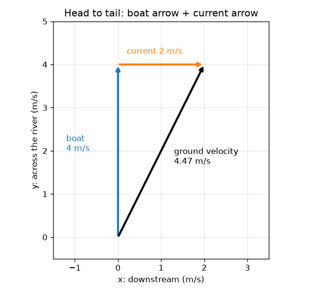
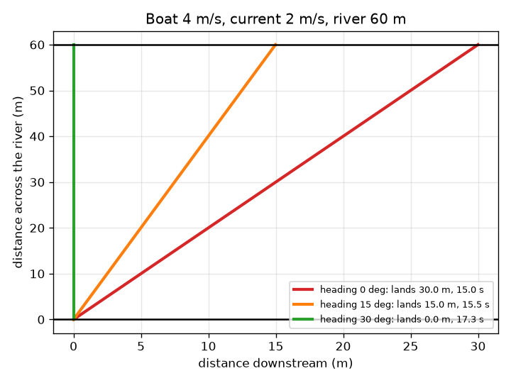

# Session 1: Arrows that add up

*Level 1 (conceptual interactive model) · about 60 minutes · openvectors*

> This is a simplified educational model. It is not a validated design tool and must not be used for real structures, electrical installations, vehicles, industrial processes or medical decisions.

**Prerequisites**

- Knowing what speed and direction mean.
- You have read PRIMER.md and run `python start.py 1` once.

**Learning objectives.** After this session you can:

- Describe a velocity as an arrow with a length (speed) and a direction.
- Add two arrows head to tail, by drawing and by adding their numbers.
- Predict where a boat lands when it crosses a river with a current.
- Choose a heading so that the boat lands straight opposite its start.

## A. Real-world problem
You row a boat at 4 m/s straight at a landing on the far bank of a 60 m wide river. The river flows past at 2 m/s. You keep pointing at the landing, but the water keeps carrying you sideways. Where do you actually land? And how should you point the boat so that you land exactly opposite?

## B. Concept and theory
A velocity is an arrow: its length is the speed and its direction is where it points. We use x for downstream (along the river) and y for across the river, so an arrow is a pair (vx, vy). The boat's own arrow is what the boat would do in still water; the current's arrow is what the water does to everything in it. The boat's real motion over the ground is the sum of the two: put the tail of the second arrow on the head of the first and draw the arrow from the first tail to the last head. With numbers, add the matching entries. Because the across part of the ground arrow is what moves the boat to the far bank, the crossing time is the width divided by that part, and the sideways drift is the along-river part times that time.

| Symbol | Meaning | Unit |
|---|---|---|
| v | boat speed through the water | m/s |
| u | current speed (downstream) | m/s |
| h | heading: angle from straight across, positive leaning upstream | degrees |
| (gx, gy) | ground arrow: along the river and across | m/s |
| W | river width (60) | m |
| T | crossing time | s |
| drift | landing point along the river, positive downstream | m |

**Assumptions**

- The river is straight with parallel banks and the current is the same everywhere (uniform).
- The boat speed through the water stays constant and the boat turns instantly.
- Everything happens in a flat plane: no waves, no wind.

$$ \mathbf g=\mathbf b+\mathbf c,\qquad \mathbf b=v(-\sin h,\ \cos h),\quad \mathbf c=(u,\ 0) $$

$$ T=\frac{W}{g_y}=\frac{W}{v\cos h} $$

$$ \text{drift}=g_x\,T=\frac{(u-v\sin h)\,W}{v\cos h} $$

$$ \text{land opposite: } g_x=0\ \Rightarrow\ \sin h=\frac{u}{v} $$

## C. Visual explanation
The left figure shows the arrows head to tail for a boat that points straight across: the blue boat arrow is 4 m/s long, the orange current arrow 2 m/s, and the black ground arrow, from the first tail to the last head, is 4.47 m/s long and leans downstream. The right figure shows three boats on the 60 m river: with heading 0 the boat lands 30.0 m downstream after 15.0 s, with heading 15 degrees it lands 15.0 m downstream after 15.5 s, and with heading 30 degrees it lands exactly opposite after 17.3 s.

*Head to tail: the boat arrow and the current arrow add up to the ground arrow.*

*Three headings on a 60 m river: 0 degrees lands 30 m downstream, 30 degrees lands opposite.*

## D. Interactive simulation
Run the lesson (`python start.py 1`), then open the live app: [Session 1: a boat crossing a river](https://krunalpanchal1995.github.io/openvectors/session-01/) (or `app.html` in this folder). Move the heading slider and watch the black ground arrow turn and the landing point slide along the bank. Open the third view and see the landing point for every heading at once.

**Challenge.** Land exactly opposite the start (within 1 m) with a boat of 4 m/s in a current of 2 m/s.

## E. Worked example and experiment
**Problem.** A boat of 4 m/s points straight across a 60 m river with a 2 m/s current. Find the ground arrow, the crossing time and the landing point. Then find the heading that lands the boat exactly opposite.

1. Boat arrow = (0, 4) m/s (straight across, nothing along the river). Current arrow = (2, 0) m/s.
2. Ground arrow = (0 + 2, 4 + 0) = (2, 4) m/s. Its length is sqrt(2^2 + 4^2) = sqrt(20) = 4.47 m/s.
3. Only the across part moves the boat to the far bank: T = 60 / 4 = 15 s.
4. Drift = 2 m/s * 15 s = 30 m downstream.
5. To land opposite the along-river part must be zero: 2 - 4 sin h = 0, so sin h = 0.5 and h = 30 degrees upstream.
6. Then gy = 4 cos 30 = 3.46 m/s, so T = 60 / 3.46 = 17.3 s: the safer landing costs 2.3 s.

**Answer.** Pointing straight across: ground arrow (2, 4) m/s, 15 s, landing 30 m downstream. Pointing 30 degrees upstream: ground arrow (0, 3.46) m/s, 17.3 s, landing exactly opposite.

**Experiment.** Walk across a school field at a steady pace while a friend pulls you sideways on a rolling platform, or use a toy boat in a slow stream and a stopwatch: mark the start and the point opposite, point the boat straight across and measure the drift and the time, then repeat with the boat tilted upstream. Expect the same pattern, a smaller drift for a tilted boat, but not the same numbers: the real current is slower near the banks, the boat does not hold a perfectly constant speed, and the toy boat turns with the water. The model is exact for its assumptions; the stream is not uniform.

## F. Assessment and design challenge
**Question type A: Conceptual.** Why must the boat point upstream to land exactly opposite its start? What does the sideways part of the boat arrow have to do?

Hint

Landing opposite means the along-river part of the ground arrow is zero.

Step-by-step solution

The ground arrow is the boat arrow plus the current arrow. The current arrow points downstream, so to make the along-river part of the sum zero the boat arrow must have an equal and opposite upstream part. That is only possible by leaning the boat upstream. The across part of the boat arrow is then a little shorter than the full boat speed, so the crossing takes longer.

**Question type B: Numerical.** A boat of 5 m/s points straight across a 60 m river with a 3 m/s current. Find the crossing time, the landing point and the speed over the ground.

Hint

Ground arrow = (3, 5). Time = width / across part.

Step-by-step solution

Ground arrow = (3, 5) m/s. T = 60 / 5 = 12 s. Drift = 3 * 12 = 36 m downstream. Speed over the ground = sqrt(3^2 + 5^2) = sqrt(34) = 5.83 m/s. Sanity check: faster than the boat alone (5 m/s) because the current helps along the river, and the 12 s is the time for 60 m at 5 m/s.

**Question type C: Graph and simulation interpretation.** On the landing-point graph, for a 4 m/s boat and a 2 m/s current, where does the curve cross zero and what is the landing point at heading 0? What does the curve do for negative headings (leaning downstream)?

Hint

Read the curve at heading 0 and where it meets the horizontal line at 0.

Step-by-step solution

At heading 0 the curve is at 30 m. It crosses zero at heading 30 degrees. For negative headings, where the boat leans downstream with the current, the landing point is larger: the boat drifts even further downstream.

**Question type D: Design and optimisation challenge.** Design: the pier is 15 m downstream of the point opposite the start. Choose a heading for the 4 m/s boat in the 2 m/s current so that it lands at the pier, and state how long the crossing takes.

Hint

Try headings in the app until the landing point reads 15 m, or compute the landing point for several headings with `crossing` from the lesson.

Step-by-step solution

A heading of about 15 degrees upstream gives a landing 15.0 m downstream (14.98 m for exactly 15 degrees) and a crossing time of about 15.5 s. Assumption: constant current and boat speed. Check: heading 0 gives 30 m and heading 30 gives 0 m, so a heading half way between lands about half way, near 15 m, because the curve is almost straight there.

Score yourself with [RUBRIC.md](../../RUBRIC.md). Print the [activity sheet](activity_sheet.md) to work on paper.

## Common misconceptions
| Common misconception | What is actually true |
|---|---|
| To cross a river straight, point the boat at the landing. | The current carries the boat while it crosses, so pointing at the landing makes it land downstream. You must lean upstream. |
| The boat's speed over the ground equals the boat speed. | The ground arrow is the sum of the boat arrow and the current arrow; its length is usually different from the boat speed. |
| Arrows are added by adding their lengths. | Arrows are added head to tail or by adding their matching numbers. Lengths add only when the arrows point the same way. |
| A bigger current always makes the crossing slower. | The current does not change the crossing time if the boat points straight across, because only the across part matters; it changes where you land. |

## Glossary
- **vector**: a quantity with a size and a direction, drawn as an arrow
- **velocity**: speed together with direction; an arrow measured in m/s
- **resultant**: the single arrow that equals a sum of arrows
- **heading**: the direction the boat points, here measured from straight across
- **drift**: how far the boat is carried along the river by the time it lands

## Finish
1. Do the three coding tasks in [exercises.md](exercises.md).
2. Run `python start.py 1` again after your changes. It ends with the checkpoint; when it prints `PASS`, you are done. (Checkpoint only: `python start.py check 1`.)

Next: [Session 2](../session-02/README.md)
