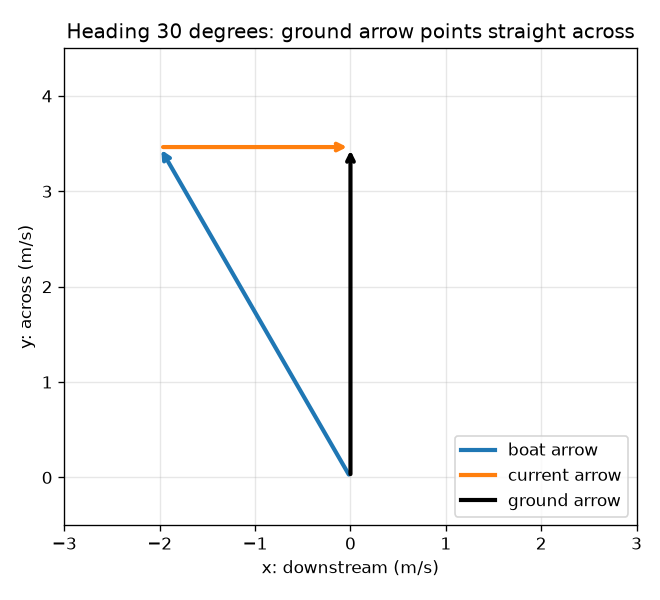
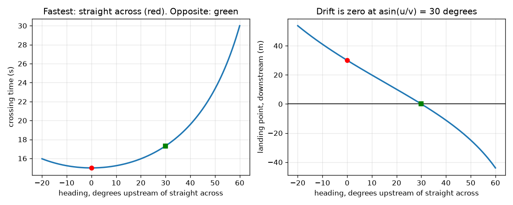

# Session 2: Components, trigonometry and the dot product

*Level 2 (mathematical engineering model) · about 75 minutes · openvectors*

> This is a simplified educational model. It is not a validated design tool and must not be used for real structures, electrical installations, vehicles, industrial processes or medical decisions.

**Prerequisites**

- Session 1: adding arrows.
- Sine, cosine and the angle of a right-angled triangle.

**Learning objectives.** After this session you can:

- Split an arrow into components and rebuild it from magnitude and angle.
- Compute the dot product, the angle between two arrows and the projection of one on the other.
- Use W = F . d to find the work done by a force.
- Solve the design problem: which heading lands the boat opposite, and which crosses fastest?

## A. Real-world problem
A ferry with speed 4 m/s must cross a 60 m wide river with a 2 m/s current. The captain has two wishes: land exactly opposite the start, and cross as fast as possible. Do they ask for the same heading? What does each cost? And how much work does a steady side wind do on the way?

## B. Concept and theory
An arrow of length r at an angle phi from the +x axis has components (r cos phi, r sin phi); going back, r = sqrt(vx^2 + vy^2) and phi = atan2(vy, vx). Adding arrows adds components. The dot product a . b = ax bx + ay by also equals |a||b| cos(angle between them): it is zero for perpendicular arrows, and (a . b) / |b| is the length of the shadow (projection) of a on b. The work of a constant force F over a displacement d is W = F . d: only the part of the force along the motion counts. For the ferry with heading h, the ground arrow has components gx = u - v sin h and gy = v cos h. Landing opposite needs gx = 0; crossing fast needs gy as large as possible, which is heading 0.

| Symbol | Meaning | Unit |
|---|---|---|
| r, phi | length and angle of an arrow from the +x axis | units of the arrow, degrees |
| (vx, vy) | components of an arrow | same as the arrow |
| a . b | dot product | product of the units |
| F, d | force and displacement arrows | N, m |
| W | work done by the force | J (joules) |
| v, u, h | boat speed, current, heading (upstream of straight across) | m/s, m/s, degrees |
| T, drift | crossing time and landing point along the river | s, m |

**Assumptions**

- Uniform current, constant boat speed, a straight river 60 m wide.
- The wind is represented only as a constant force when we compute work; it does not change the boat's motion here.
- The heading is between -90 and 90 degrees exclusive: at 90 degrees the boat would never cross.

$$ \mathbf v=(r\cos\varphi,\ r\sin\varphi),\qquad r=\sqrt{v_x^2+v_y^2},\quad \varphi=\operatorname{atan2}(v_y,v_x) $$

$$ \mathbf a\cdot\mathbf b=a_xb_x+a_yb_y=|\mathbf a||\mathbf b|\cos\theta,\qquad \text{projection}=\frac{\mathbf a\cdot\mathbf b}{|\mathbf b|} $$

$$ W=\mathbf F\cdot\mathbf d $$

$$ g_x=u-v\sin h,\quad g_y=v\cos h,\quad T=\frac{W_r}{v\cos h},\quad \text{drift}=g_xT\ \ (W_r=60\ \mathrm{m}) $$

$$ \text{opposite: } h=\arcsin\frac{u}{v}\ (u<v);\qquad \text{fastest: } h=0 $$

## C. Visual explanation
The first figure draws the boat arrow, the current arrow and the ground arrow for the heading that lands opposite (30 degrees): the black ground arrow points straight across and its dashed x component is zero. The second figure plots the crossing time and the landing point against the heading for v = 4 m/s and u = 2 m/s. The time curve has its minimum, 15 s, at heading 0 (red dot) and grows as the boat leans more; the landing curve falls through zero at 30 degrees (green square, time 17.3 s). Leaning more than 30 degrees makes the boat land upstream of the pier.

*At heading 30 degrees the ground arrow points straight across.*

*Crossing time (left) and landing point (right) against heading: fastest at 0 degrees, opposite at 30 degrees.*

## D. Interactive simulation
Run the lesson (`python start.py 2`), then open the live app: [Session 2: components and the crossing equations](https://krunalpanchal1995.github.io/openvectors/session-02/) (or `app.html` in this folder). Choose a heading and read the components of the ground arrow. In the time and landing views see where the red dot sits, and watch the green dot appear only when the current is slower than the boat.

**Challenge.** With the boat at 4 m/s and the current at 2 m/s, land within 2 m of the opposite point and cross in under 18 s.

## E. Worked example and experiment
**Problem.** Boat 4 m/s, current 2 m/s, river 60 m. Find (a) the heading that lands opposite, with its time; (b) the fastest crossing, with its landing point; (c) the work of a 20 N wind force pushing downstream while the boat goes straight across.

1. (a) Opposite needs gx = 2 - 4 sin h = 0, so sin h = 0.5 and h = 30 degrees. gy = 4 cos 30 = 3.464 m/s, so T = 60 / 3.464 = 17.32 s.
2. (b) Fastest: gy = 4 cos h is largest at h = 0, gy = 4 m/s, T = 60 / 4 = 15 s. Drift = gx T = 2 * 15 = 30 m downstream.
3. (c) The displacement of the boat over the ground is d = (30, 60) m. The force is F = (20, 0) N.
4. W = F . d = 20 * 30 + 0 * 60 = 600 J. Only the along-river part of the displacement matters.
5. Check with the angle: |d| = sqrt(30^2 + 60^2) = 67.08 m, cos(angle) = 600 / (20 * 67.08) = 0.447, angle = 63.4 degrees; W = 20 * 67.08 * cos 63.4 = 600 J.

**Answer.** (a) 30 degrees upstream, 17.32 s, landing opposite. (b) Straight across, 15 s, landing 30 m downstream. (c) 600 J.

**Experiment.** Pull a toy cart with a spring balance at different angles to the rail and compare the work (force times distance along the rail) with F d cos(angle): at 60 degrees the work should be half of the straight pull. The model is exact for a constant force; in practice friction, and a force that changes as the angle changes, make the numbers differ a little. For the boat, time the real crossing in a stream with a stopwatch and compare with 60 / (v cos h); a real stream is slower near the banks.

## F. Assessment and design challenge
**Question type A: Conceptual.** Why is the fastest crossing always at heading 0, even when there is a current? Why does tilting upstream make the crossing slower?

Hint

Which component of the ground arrow carries the boat to the far bank?

Step-by-step solution

Only gy = v cos h carries the boat across, and the current has no across part. cos h is largest (1) at h = 0, so gy is largest and T = W / gy is smallest. Tilting trades some of the across speed for an upstream speed, so it cannot be faster; it is done only to cancel drift.

**Question type B: Numerical.** For a boat of 5 m/s and a current of 3 m/s on a 60 m river, find the heading that lands opposite, the crossing time, and the time and landing point of the fastest crossing.

Hint

sin h = u / v. Use the 3-4-5 triangle.

Step-by-step solution

sin h = 3/5 = 0.6, so h = 36.87 degrees. gy = 5 cos 36.87 = 4 m/s, T = 60 / 4 = 15 s. Fastest: h = 0, T = 60 / 5 = 12 s, drift = 3 * 12 = 36 m downstream. So the safe landing costs 3 s.

**Question type C: Graph and simulation interpretation.** From the crossing-time graph (v = 4, u = 2), what are the times at headings 0 and 30 degrees, and why does the curve rise slowly at first and then steeply?

Hint

T = 60 / (4 cos h), and cos is flat near 0.

Step-by-step solution

T = 15 s at 0 degrees and 17.3 s at 30 degrees. Near h = 0 the cosine barely changes, so T hardly changes; at larger angles cos h falls quickly, so T rises steeply (at 60 degrees T = 30 s).

**Question type D: Design and optimisation challenge.** Design: the timetable allows at most 16 s for the 4 m/s ferry in the 2 m/s current, and the pier tolerates a landing within 5 m of the opposite point. Is there a heading that meets both? If not, which limit would you relax and by how much?

Hint

Time at most 16 s gives cos h >= 60 / (4 * 16). Then check the landing point at the largest allowed heading.

Step-by-step solution

At most 16 s needs cos h >= 0.9375, so h <= 20.4 degrees; at that heading the landing point is still 9.7 m downstream, so no heading gives both limits. Options: accept a landing within 10 m (headings 20.1 to 20.4 degrees work) or allow 17 s (headings from 25.1 to 28.1 degrees land within 5 m). The trade-off is time against accuracy; the pier decides.

Score yourself with [RUBRIC.md](../../RUBRIC.md). Print the [activity sheet](activity_sheet.md) to work on paper.

## Common misconceptions
| Common misconception | What is actually true |
|---|---|
| The dot product of two arrows is another arrow. | It is a single number (a scalar): ax bx + ay by. |
| Use arctan(vy / vx) for any arrow's angle. | That loses the quadrant: for (-1, 1) it gives -45 degrees. Use atan2(vy, vx), which gives 135 degrees. |
| Landing opposite is always possible if you steer well enough. | It needs the current to be slower than the boat: sin h = u / v has no solution when u >= v. |
| A force always does work equal to its size times the distance. | Work is the force times the part of the distance along the force: F d cos(angle). A force at right angles to the motion does no work. |

## Glossary
- **component**: the part of an arrow along one axis
- **magnitude**: the length of an arrow
- **dot product**: a . b = ax bx + ay by, a number that also equals |a||b| cos(angle)
- **projection**: the shadow of one arrow on the direction of another
- **work**: force times displacement along the force, in joules

## Finish
1. Do the three coding tasks in [exercises.md](exercises.md).
2. Run `python start.py 2` again after your changes. It ends with the checkpoint; when it prints `PASS`, you are done. (Checkpoint only: `python start.py check 2`.)

Next: [Session 3](../session-03/README.md)
