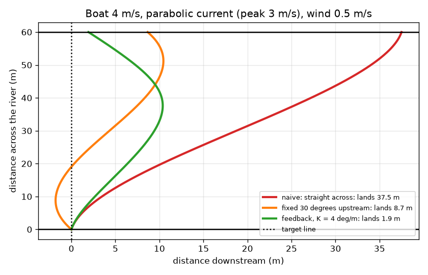
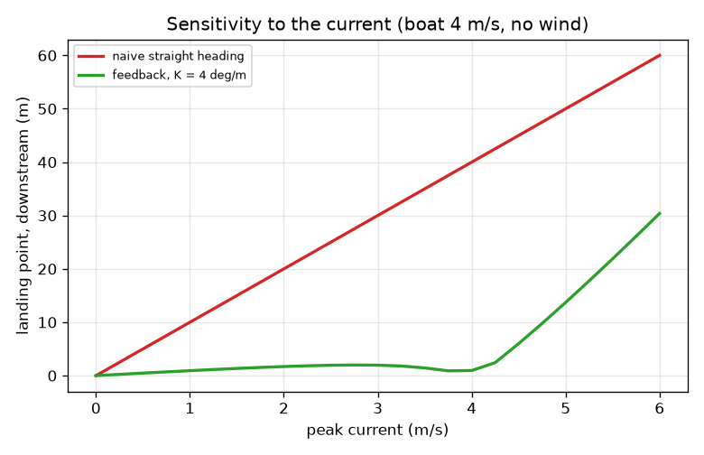

# Session 3: A river that changes, and a boat that corrects itself

*Level 3 (simulation and validation) · about 90 minutes · openvectors*

> This is a simplified educational model. It is not a validated design tool and must not be used for real structures, electrical installations, vehicles, industrial processes or medical decisions.

**Prerequisites**

- Session 1: adding arrows.
- Session 2: components and the crossing equations.

**Learning objectives.** After this session you can:

- Simulate a boat in small time steps with a current that depends on position.
- Compare a fixed heading with a feedback heading that corrects to a target line.
- Validate the simulation against the exact formulas, and test how the answer changes with the time step and the current.
- Find and explain the failure case: a current that is faster than the boat.

## A. Real-world problem
Real rivers flow fastest in the middle and slowly near the banks, and the wind pushes the boat too. A fixed heading that works for a uniform current misses the landing. A ferry pilot watches where the boat is drifting and steers back towards the landing line. How can we simulate that, trust the simulation, and find out when no pilot could succeed? This is a simplified educational model, not a navigation tool.

## B. Concept and theory
We time-step the boat: at every small step dt we compute the boat's arrow, add the current's arrow at the boat's present position, and move the boat along the ground arrow. The current is parabolic: u(y) = 4 umax (y/W)(1 - y/W), zero at both banks and umax in mid-river, with an average of (2/3) umax. A side wind adds a constant w downstream. The naive pilot keeps one heading. The feedback pilot measures the cross-track error x (how far downstream of the target line the boat is) and sets heading = K x + Ki (sum of x dt), limited to +-60 degrees; K is in degrees per metre and Ki = K / 20. We solve the equations with the fourth-order Runge-Kutta method, and we validate against exact results: for a fixed heading the time is W / (v cos h) and the drift is (average current + wind - v sin h) times that time.

| Symbol | Meaning | Unit |
|---|---|---|
| x, y | boat position: downstream and across the river | m |
| v | boat speed through the water | m/s |
| umax | peak current in mid-river | m/s |
| w | side wind push, positive downstream | m/s |
| theta | heading, positive leaning upstream | degrees |
| K | feedback gain | degrees per metre |
| dt | time step (0.05) | s |

**Assumptions**

- Flat 2D water; the current depends only on the distance across the river.
- The wind is a constant sideways push; there are no waves and no boat inertia: the heading changes instantly.
- The pilot knows the boat's position exactly and cannot turn more than 60 degrees from straight across.

$$ \dot x=u(y)+w-v\sin\theta,\qquad \dot y=v\cos\theta $$

$$ u(y)=4u_{\max}\frac{y}{W}\left(1-\frac{y}{W}\right),\qquad \bar u=\tfrac23u_{\max} $$

$$ \theta=\operatorname{clip}\!\Big(Kx+K_i\!\int x\,dt,\ \pm60^\circ\Big),\qquad K_i=K/20 $$

$$ \text{fixed heading: } T=\frac{W}{v\cos\theta},\quad \text{drift}=(\bar u+w-v\sin\theta)\,T $$

$$ u>v\ (\text{uniform}):\quad \text{smallest drift}=\frac{W\sqrt{u^2-v^2}}{v}\ \text{at}\ \sin\theta=\frac vu $$

## C. Visual explanation
The first figure shows three paths for a 4 m/s boat, a parabolic current with a 3 m/s peak and a 0.5 m/s wind. Red: the fixed heading straight across lands 37.5 m downstream after 15 s. Orange: a fixed 30 degree heading, tuned for a uniform 2 m/s current, still lands 8.7 m downstream. Green: the feedback heading with K = 4 lands 1.9 m downstream but takes 20.8 s. The second figure plots the landing point against the peak current with no wind: the red fixed-heading line rises by 10 m for every extra 1 m/s of peak current, while the green feedback curve stays within about 2 m up to a 4 m/s peak and then rises as the boat reaches its heading limit.

*Fixed heading (red), a tuned fixed 30 degree heading (orange) and feedback (green) on the same river.*

*Landing point against the peak current: the fixed heading drifts 10 m per m/s; feedback stays near the line until the current beats the boat.*

## D. Interactive simulation
Run the lesson (`python start.py 3`), then open the live app: [Session 3: a changing current and a feedback pilot](https://krunalpanchal1995.github.io/openvectors/session-03/) (or `app.html` in this folder). Compare the red and green paths while you change the peak current, the wind and the gain K. Then open the heading view to see how the controller turns upstream, and push the peak current to 6 m/s to find the failure.

**Challenge.** With a boat of 4 m/s, a peak current of 3 m/s and a wind of 0.5 m/s, raise the gain until the feedback boat lands within 2 m of the target.

## E. Worked example and experiment
**Problem.** Boat 4 m/s, parabolic current with a 3 m/s peak, no wind, fixed heading straight across a 60 m river. Predict the drift and the time exactly, then compare with the simulation. Then add a 0.5 m/s wind.

1. Time: T = 60 / 4 = 15 s for any current, because the across speed is 4 m/s.
2. The average current is (2/3) * 3 = 2 m/s, so the drift is 2 * 15 = 30 m. (This equals the integral of 4 * 3 (y/60)(1 - y/60) divided by the 4 m/s across speed.)
3. Simulation with dt = 0.05 s and Runge-Kutta: 30.000 m after 15.000 s.
4. With a 0.5 m/s wind the extra drift is 0.5 * 15 = 7.5 m, so the exact answer is 37.5 m, and the simulation gives 37.500 m.
5. Simulation versus the exact formula over 21 headings from -40 to 60 degrees: the largest difference is below 0.001 m, so the solver can be trusted here.

**Answer.** Exact and simulated: 30.0 m drift in 15.0 s without wind, 37.5 m with a 0.5 m/s wind. The feedback boat in the same conditions (K = 4) lands 1.9 m downstream after 20.8 s.

**Experiment.** Measure a real river or a stream: put markers across it, time a floating leaf at three distances from the bank, and see that the middle is faster than the edge. Cross with a boat or a swimmer holding one heading and measure the drift. A parabolic profile will fit only roughly: real streams have eddies, a rough bed and a changing wind, and a pilot cannot turn instantly. The simulation shows the trend and the size of the effects, not the exact landing.

## Real-world application and mini-project: Plan a ferry route
A ferry with speed 4 m/s crosses a 60 m river with a 0.5 m/s side wind. The current is parabolic, with a peak of 2, 3 or 4 m/s depending on the season. The harbour wants the ferry to land within 2 m of the opposite pier and to cross in at most 23 s. Use `simulate` from Session 3 and scan the feedback gain K from 0.5 to 8 in steps of 0.5 for each peak current.

**Deliverable:** A script that prints, for each peak current, the landing point and crossing time for every K, names the smallest K that meets both limits (or says that none does), and saves one picture with the three chosen routes.

**Success looks like:** The smallest passing gain is 4.5 for a 2 m/s peak and 4.0 for a 3 m/s peak, and no gain passes for a 4 m/s peak (the best landing is 6.0 m at K = 8); you explain why in one paragraph using the arrows: the stream plus the wind is faster than the boat in mid-river.

## F. Assessment and design challenge
**Question type A: Conceptual.** Why does the feedback pilot use an integral term (the running sum of the error) as well as the proportional term K x?

Hint

What heading does the boat need to hold in a steady wind, and what error does a purely proportional rule need in order to produce that heading?

Step-by-step solution

In a steady current and wind the boat needs a steady upstream heading just to stay on the line. A purely proportional rule produces a heading only when there is an error (heading = K x), so it must settle with a leftover error. The integral term keeps growing while the error persists and supplies the steady heading without a leftover error. Too much of it makes the boat overshoot the line.

**Question type B: Numerical.** Using the exact formula, find the drift of a 4 m/s boat that points straight across a 60 m river with a parabolic current of peak 5 m/s and no wind. Check it against the sensitivity graph.

Hint

Drift = (2/3) umax * W / v for heading 0.

Step-by-step solution

Average current = (2/3) * 5 = 3.33 m/s; T = 15 s; drift = 3.33 * 15 = 50 m. This matches the red line of the sensitivity graph (10 m for each m/s of peak current: 5 * 10 = 50 m).

**Question type C: Graph and simulation interpretation.** In the sensitivity graph, what is the feedback landing point for peak currents of 3, 5 and 6 m/s, and why does it get worse above 4 m/s?

Hint

Read the green curve; think about the heading limit and the current plus the boat speed in mid-river.

Step-by-step solution

About 2.0 m at 3 m/s, 13.7 m at 5 m/s and 30.4 m at 6 m/s (the fixed heading gives 30, 50 and 60 m). Above 4 m/s the current in mid-river is faster than the boat, so no heading can hold the boat on the line there, and the heading is capped at 60 degrees; the boat is swept downstream in the middle and cannot fully return.

**Question type D: Design and optimisation challenge.** Design: for the 4 m/s boat, the parabolic current with a 3 m/s peak and a 0.5 m/s wind, choose the gain K (in steps of 0.5) so that the landing is within 2 m and the crossing takes at most 21 s. Justify your choice.

Hint

Run `simulate(4, 3, 0.5, K=...)` for K = 3.5, 4, 4.5 and 5 and compare the landing point and the time.

Step-by-step solution

K = 3.5 lands 3.2 m off (too far). K = 4 lands 1.9 m off in 20.8 s: it meets both limits. K = 4.5 lands 1.0 m off but takes 21.2 s, over the limit; K = 5 lands 0.4 m off in 21.6 s. So K = 4 is the only half-step gain that satisfies both. Trade-off: a larger gain lands closer to the target but swings the heading upstream harder, so the crossing takes longer.

Score yourself with [RUBRIC.md](../../RUBRIC.md). Print the [activity sheet](activity_sheet.md) to work on paper.

## Common misconceptions
| Common misconception | What is actually true |
|---|---|
| A simulation is right if its graph looks right. | Compare it with an exact case: the fixed-heading drift and time here match the formulas to better than 1 mm, and the answer must not change much when the time step shrinks. |
| Feedback can always fix any current. | Feedback uses the same boat speed. If the current is faster than the boat, even the best fixed heading drifts at least W sqrt(u^2 - v^2) / v, and no controller can beat that physical limit. |
| A bigger gain is always better. | A bigger gain lands closer to the line but turns the boat harder upstream and lengthens the crossing; with too much, the boat overshoots. |
| The current in a river is the same everywhere. | It is slow near the banks and fastest in the middle; the average of a parabola is two thirds of its peak. |

## Glossary
- **feedback**: using a measurement of the error to decide the next control action
- **cross-track error**: how far the boat is from the target line, measured sideways
- **gain**: how strongly the controller reacts to the error (K)
- **time step**: the small interval dt over which the simulation assumes nothing changes
- **Runge-Kutta**: a numerical method that uses several slopes inside each step to be more accurate
- **validation**: checking a simulation against an exact or trusted result

## Finish
1. Do the three coding tasks in [exercises.md](exercises.md).
2. Run `python start.py 3` again after your changes. It ends with the checkpoint; when it prints `PASS`, you are done. (Checkpoint only: `python start.py check 3`.)

Next: the [roadmap](../../promo/roadmap.md). Session 4 is yours to build.
